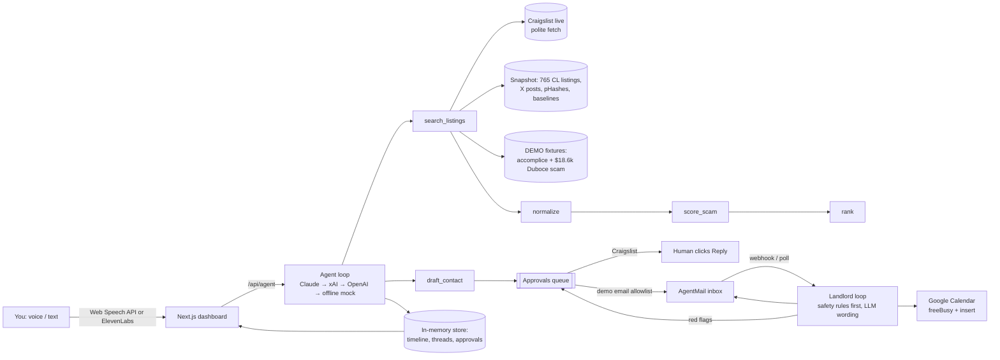

# 🎯 Sublet Sniper

**A voice agent that finds a safe short-term rental in San Francisco, talks to landlords for you, and refuses to get scammed.**

In August 2026 a renter wired **$18,600** for a $6,200/mo Duboce Triangle 2BR that was copied from a real Zillow listing ([SF Standard](https://sfstandard.com), KQED, ABC7). Sublet Sniper reads live Craigslist + X, normalizes the mess (weekly prices, totals, Spanish dates), ranks by what you asked (budget, dates, furnished, distance to Caltrain/BART/UCSF), and puts a **traffic light with explained reasons** on every listing. Then it runs the landlord conversation from its own mailbox, negotiates inside your budget, asks for a live video tour, books the viewing on your calendar, and only pings you for decisions.

Built for the Puentes hackathon (SF, 2026-10-24).

## What it does

| Tool | What it does |
|---|---|
| `search_listings` | Live Craigslist SF (`sub`, `apa`, `roo`), polite (≥3 s between requests, browser UA, 10 min cache), falls back per category to a 765-listing real snapshot; plus X posts snapshot and labeled demo fixtures |
| `normalize` | Heuristics (price period, totals vs nights, type, furnished, dates, in-SF) + optional LLM pass validated with zod |
| `rank` | Budget (hard cap 110%), type, furnished, date overlap, haversine distance to named places; scam light penalizes |
| `score_scam` | Green / yellow / red with reasons: wire/Zelle/gift card/out-of-country keywords, price < 60% of the neighborhood median (Apartment List / Zumper / Craigslist medians), duplicate text (shingle Jaccard), duplicate photos (pHash Hamming ≤ 6), upfront > 2× rent (CA AB 12), new X accounts, empty bodies |
| `draft_contact` | Drafts the first message into the **approvals queue**. Craigslist: approving copies the text and opens the listing, the human clicks Reply (captcha). Email only to allowlisted demo addresses |
| landlord loop | AgentMail inbox: answers from the renter profile, counters inside budget, asks for a video walkthrough / leaseholder proof, proposes slots; **refuses and flags** deposit-before-viewing, Zelle, wire, crypto, "out of the country", keys by mail |
| `propose_slots` / `book_viewing` | Google Calendar freeBusy + events.insert (booking needs your approval) or mock calendar |
| `ask_owner_decision` | Goes to the approvals queue; the only time you get pinged |

Dashboard: chat + voice (🎤 Web Speech API in/out, optional ElevenLabs widget), ranked cards with traffic lights, flagged tab, a thread per landlord, the agent's action timeline, and the approvals queue.

## Architecture



## Setup

```bash
git clone https://github.com/ariasnico/sublet-sniper && cd sublet-sniper
npm install
cp .env.example .env.local   # optional: everything works with zero keys
npm run dev                  # http://localhost:3000
npm test                     # vitest on real snapshot data
npm run build
```

Modes (shown as pills in the header): with no keys you get the deterministic offline agent (Spanish/English), live Craigslist (or `CRAIGSLIST_LIVE=0` for snapshot), mock mail with "Simulate DEMO landlord" buttons, mock calendar, and browser voice. Add keys to go live, see `.env.example` for where to get each one.

**Deploy to Vercel:** import the repo, add env vars, done. Note: the store is in-memory (per server instance), which is fine for a demo but not for production.

**AgentMail live:** create an inbox, set `AGENTMAIL_API_KEY`, `AGENTMAIL_INBOX_ID`, `DEMO_LANDLORD_EMAIL` (your teammate). On Vercel add a webhook to `https://<host>/api/mail/webhook?token=<WEBHOOK_TOKEN>` for `message.received`; locally press **Check mail**.

## 3-minute demo script

1. **(0:00) Hook.** "In August someone wired $18,600 for an SF apartment that didn't exist. We built the agent that would have stopped it."
2. **(0:20) Voice search.** Click 🎤 and say: *"Busco depto amoblado cerca de Caltrain, menos de 4 mil, del 1 de noviembre al 15 de diciembre."* The agent scans ~770 live listings, answers out loud with the top 3, and calls out the red one.
3. **(0:50) Cards.** Show the ranked cards (price per month even when the post was weekly, km to Caltrain, why it fits). Open **🚩 Flagged**: the Duboce fixture (DEMO DATA) is red: wire, Zelle, out of the country, upfront > 2× rent, same photos as the original listing (pHash).
4. **(1:20) Contact.** Say *"Contactá al demo de Mission Bay."* The draft lands in **Approvals**. Approve. (For a real Craigslist listing, approving opens the page and you click Reply yourself: captcha + ToS.)
5. **(1:40) Landlord conversation.** The teammate replies to the agent's AgentMail address (or press **hello / video / slot** in mock). The agent counters within budget, asks for a video tour, offers three free slots from the calendar, and when the landlord picks one asks you to confirm. Approve, and the event is on the calendar.
6. **(2:30) Scam attempt.** The teammate writes "I'm out of the country, Zelle the deposit today" (or press **scam**). The agent refuses, the thread turns red, and you get a single decision: drop it?
7. **(2:50) Close.** Show the timeline: everything the agent did, and the only three times it needed you.

## Honest limitations

- **Craigslist contact needs a human.** Replies go through Craigslist's relay behind an hCaptcha, and its ToS forbids robots and unsolicited messages. We never auto-contact Craigslist and never solve captchas; the human clicks Reply. Fetching is low volume (≥3 s between requests, browser UA, cache) and falls back to a snapshot, but scraping is still against Craigslist's ToS. For a real product you'd want a licensed feed or user-initiated browsing.
- **Only demo/allowlisted addresses are emailed.** Real landlords are never contacted by the agent. No SMS or AI calls (TCPA / FCC-24-17).
- X data is a snapshot (live X DMs need a paid dev app and OAuth user token); most "sublet" posts on X are noise.
- Scam scoring is heuristic and explainable, not a guarantee. Duplicate-photo detection only covers images we've hashed.
- State is in memory (resets on redeploy / cold start). Google Calendar uses a refresh token from your own OAuth client (Testing mode).
- Demo data is clearly labeled `[DEMO DATA]`: the Mission Bay accomplice listing (a teammate plays the landlord) and the Duboce scam fixture modeled on the real case.

## Engineering notes

Applied [poteto](https://github.com/poteto/noodle/tree/main/.agents/skills) skills: **testing** (fixture tests on the real snapshot, a full flow test from search to booking to scam refusal), **ts-best-practices** (discriminated unions with `never` exhaustiveness, zod at every boundary, no `any`), **react-best-practices** (no derived-state effects, single polling effect, parallel tool execution with `Promise.all`).
