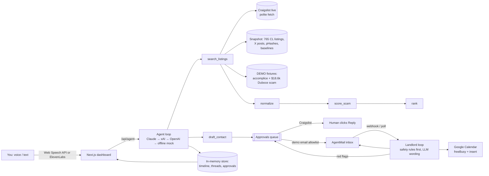

# 🎯 Sublet Sniper

**Your rental agent for San Francisco. Say what you want; it searches, blocks scams, emails and phones the landlord, negotiates, and books the viewing. You just show up.**

**Live:** https://sublet-sniper.vercel.app · **App:** https://sublet-sniper.vercel.app/app (Continue as guest) · **MCP:** `https://sublet-sniper.vercel.app/api/mcp`

**Who it's for:** anyone moving to SF for 1 to 6 months (interns, new hires, founders in a batch, visiting researchers) who has to rent sight unseen. That gap lives on Craigslist sublets, and it's exactly who scammers target: "I'm abroad, Zelle me the deposit." In August 2026 a renter wired **$18,600** for a Duboce Triangle 2BR copied from a real Zillow listing (SF Standard, KQED, ABC7).

**What's different:** listing sites show you listings. Sublet Sniper *acts* for you:
- **Scam X-ray** on every listing: deterministic, explainable score (price vs SF median, payment red flags, duplicate text, reused photos via pHash, upfront > 2x rent per CA AB 12).
- **Calls the landlord** with an ElevenLabs voice agent (Twilio number): refuses any payment before a viewing, negotiates on a fixed ladder inside your budget, books the viewing mid-call. Live captions stream on screen while the call happens.
- **Emails the landlord** from its own AgentMail inbox and keeps negotiating by email.
- **One human step:** pick the listing. Then add the viewing to your calendar.
- **Agent-native:** the same powers over MCP (`search_sublets`, `check_listing_scam`, `contact_landlord`, `get_deals`, `ask_agent`), plus `llms.txt`.
- **Multi-tenant:** Supabase auth (magic link or guest) with row-level security.

Built for the Puentes hackathon (SF, 2026-10-24). Demo script: [docs/DEMO.md](docs/DEMO.md).

## What it does

| Tool | What it does |
|---|---|
| `search_listings` | Live Craigslist SF (`sub`, `apa`, `roo`), polite (≥3 s between requests, browser UA, 10 min cache), falls back per category to a 765-listing real snapshot; plus X posts snapshot and labeled demo fixtures |
| `normalize` | Heuristics (price period, totals vs nights, type, furnished, dates, in-SF) + optional LLM pass validated with zod |
| `rank` | Budget (hard cap 110%), type, furnished, date overlap, haversine distance to named places; scam light penalizes |
| `score_scam` | Green / yellow / red with reasons: wire/Zelle/gift card/out-of-country keywords, price < 60% of the neighborhood median (Apartment List / Zumper / Craigslist medians), duplicate text (shingle Jaccard), duplicate photos (pHash Hamming ≤ 6), upfront > 2× rent (CA AB 12), new X accounts, empty bodies |
| `draft_contact` | Drafts the first message into the **approvals queue**. Craigslist: approving copies the text and opens the listing, the human clicks Reply (captcha). Email only to allowlisted demo addresses |
| landlord loop | AgentMail inbox: answers from the renter profile, counters inside budget, asks for a video walkthrough / leaseholder proof, proposes slots; **refuses and flags** deposit-before-viewing, Zelle, wire, crypto, "out of the country", keys by mail |
| `propose_slots` / `book_viewing` | Google Calendar freeBusy + events.insert (booking needs your approval) or mock calendar |
| `ask_owner_decision` | Goes to the approvals queue; the only time you get pinged |

Dashboard: chat + voice (🎤 Web Speech API in/out, optional ElevenLabs widget), ranked cards with traffic lights, flagged tab, a thread per landlord, the agent's action timeline, and the approvals queue.

## Architecture



## Setup

```bash
git clone https://github.com/ariasnico/sublet-sniper && cd sublet-sniper
npm install
cp .env.example .env.local   # optional: everything works with zero keys
npm run dev                  # http://localhost:3000
npm test                     # vitest on real snapshot data
npm run build
```

Modes (shown as pills in the header): with no keys you get the deterministic offline agent (Spanish/English), live Craigslist (or `CRAIGSLIST_LIVE=0` for snapshot), mock mail with "Simulate DEMO landlord" buttons, mock calendar, and browser voice. Add keys to go live, see `.env.example` for where to get each one.

**Deploy to Vercel:** import the repo, add env vars, done. Without Supabase env vars the app is single-tenant (one in-memory session per server instance).

**Accounts (multi-tenant, Supabase):** with `NEXT_PUBLIC_SUPABASE_URL` + `NEXT_PUBLIC_SUPABASE_PUBLISHABLE_KEY` (or `_ANON_KEY`) + `SUPABASE_SERVICE_ROLE_KEY` set, `/app` requires sign-in (`/login`: email magic link, or **Continue as guest** = Supabase anonymous sign-in, falling back to a throwaway confirmed user if anonymous sign-ins are off). Each user's whole session lives in `public.sessions` (one jsonb row, RLS: own row only); API routes run inside an AsyncLocalStorage tenant context (`src/lib/tenant.ts`, `src/lib/session.ts`), so `state()` is per user. The shared AgentMail inbox is split by a `#<8-hex user id>` tag on subjects plus `public.thread_index`; calls are routed by `public.call_index` and the `user_id` dynamic variable (re-run `scripts/elevenlabs-setup.mjs` to add it to the agent's tools). `/api/mcp` stays a shared, no-login demo tenant (the global session). `AUTH_MODE=off` forces single-tenant.
- Schema: `supabase/migrations/*.sql`, applied with `node --env-file=.env.local scripts/migrate.mjs`. RLS check: `node --env-file=.env.local scripts/rls-smoke.mjs`.
- Supabase dashboard (Authentication): Site URL `https://sublet-sniper.vercel.app`; redirect URLs `https://sublet-sniper.vercel.app/**`, `http://localhost:3005/**`; enable Anonymous sign-ins for the guest button. The built-in email sender is rate-limited (a few emails per hour, project-wide), so use **Continue as guest** for demos or configure custom SMTP.

**AgentMail live:** create an inbox, set `AGENTMAIL_API_KEY`, `AGENTMAIL_INBOX_ID`, `DEMO_LANDLORD_EMAIL` (your teammate). On Vercel add a webhook to `https://<host>/api/mail/webhook?token=<WEBHOOK_TOKEN>` for `message.received`; locally press **Check mail**.

## Use it from your agent

Sublet Sniper is agent-native: the web app and a remote **MCP server** (Streamable HTTP, stateless) share the same code and safety rules. Endpoint: `https://sublet-sniper.vercel.app/api/mcp`. Agent-readable overview: [`/llms.txt`](https://sublet-sniper.vercel.app/llms.txt).

| MCP tool | What it does |
|---|---|
| `search_sublets` | `{ query?, maxBudget?, type?, furnished?, from?, to?, near? }` → top safe matches (id, title, $/mo, neighborhood, scam score + light, url, photo) and the scams it caught |
| `check_listing_scam` | `{ url }` (Craigslist only) → score 0-100, light, structured signals, one-line verdict |
| `contact_landlord` | `{ listingId }` → emails only the allowlisted demo landlord; for real Craigslist listings returns the draft + URL, a human clicks Reply |
| `get_deals` | threads with status, negotiation (listed / asked / offered), safety checks, booked viewings with a Google Calendar link |
| `ask_agent` | `{ message }` → the same chat agent as the web UI |

**Claude Code**

```bash
claude mcp add --transport http sublet-sniper https://sublet-sniper.vercel.app/api/mcp
# if the deployment sets MCP_TOKEN:
claude mcp add --transport http sublet-sniper https://sublet-sniper.vercel.app/api/mcp --header "Authorization: Bearer $MCP_TOKEN"
```

**Claude Desktop / claude.ai:** Settings → Connectors → *Add custom connector* → name `Sublet Sniper`, URL `https://sublet-sniper.vercel.app/api/mcp`.

**ChatGPT:** Settings → Apps & Connectors → Advanced → enable *Developer mode*, then *Create* a connector with URL `https://sublet-sniper.vercel.app/api/mcp` and authentication *No authentication*.

Custom connectors in Claude and ChatGPT don't send static bearer headers, so leave `MCP_TOKEN` unset for them (demo mode). Set `MCP_TOKEN` to lock the endpoint to clients that can send `Authorization: Bearer <token>` (Claude Code, MCP Inspector, `mcp-remote --header`).

Try it locally: `npx @modelcontextprotocol/inspector --cli http://localhost:3000/api/mcp --transport http --method tools/list`.

## 2-minute demo

See [docs/DEMO.md](docs/DEMO.md). In short: ask for a furnished 1BR under $4,000 → ~770 live listings scanned, scams blocked → open a red listing's Scam X-ray → **Handle** any listing → the agent emails, then phones the landlord (a teammate) → it refuses the Zelle deposit, counters $3,400, agrees $3,600 and books Monday 6 PM, with live captions → booked ticket with your next steps.

## Honest limitations

- **Craigslist contact needs a human.** Replies go through Craigslist's relay behind an hCaptcha, and its ToS forbids robots and unsolicited messages. We never auto-contact Craigslist and never solve captchas; the human clicks Reply. Fetching is low volume (≥3 s between requests, browser UA, cache) and falls back to a snapshot, but scraping is still against Craigslist's ToS. For a real product you'd want a licensed feed or user-initiated browsing.
- **Only the allowlisted demo landlord is emailed or called.** Real landlords are never contacted by the agent (AI voice calls need consent under TCPA / FCC-24-17). In demo mode, whichever listing you pick is played by the demo landlord.
- X data is a snapshot (live X DMs need a paid dev app and OAuth user token); most "sublet" posts on X are noise.
- Scam scoring is heuristic and explainable, not a guarantee. Duplicate-photo detection only covers images we've hashed.
- Session state is one JSON row per user in Supabase (RLS); live captions use Twilio real-time transcription. Google Calendar uses a refresh token from your own OAuth client (Testing mode).
- Demo data is clearly labeled `[DEMO DATA]`: the Mission Bay accomplice listing (a teammate plays the landlord) and the Duboce scam fixture modeled on the real case.

## Engineering notes

Applied [poteto](https://github.com/poteto/noodle/tree/main/.agents/skills) skills: **testing** (fixture tests on the real snapshot, a full flow test from search to booking to scam refusal), **ts-best-practices** (discriminated unions with `never` exhaustiveness, zod at every boundary, no `any`), **react-best-practices** (no derived-state effects, single polling effect, parallel tool execution with `Promise.all`).
